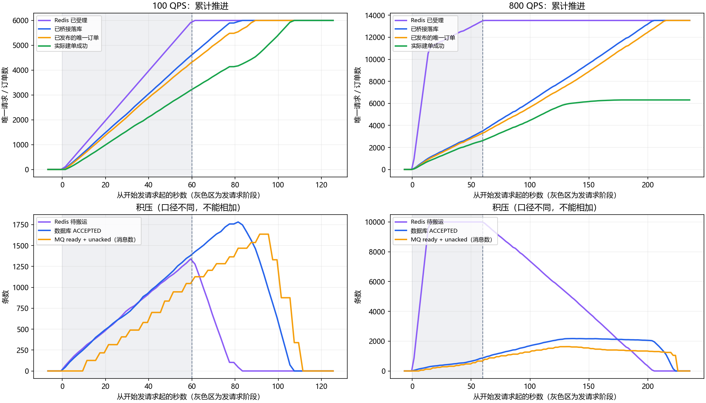

# 秒杀各阶段速率：2026-10-13

## 测量结论

没有改动秒杀业务逻辑。使用真实链路和独立观察脚本，确认当前存在两处推进瓶颈：Redis任务桥接慢于入口；消费建单又慢于桥接/发布。当前负载下消息发布不是最慢的一段。

| 阶段 | 100 QPS加载期间（条/秒） | 800 QPS达到积压上限后（条/秒） |
| --- | ---: | ---: |
| Redis成功受理 | 99.99 | 52.57 |
| 桥接数据库的唯一请求 | 78.75 | 52.57 |
| 已确认发布的唯一订单 | 74.73 | 51.13 |
| 实际建单成功 | 56.23 | 41.19 |

100 QPS窗口取发请求后11.4–49.4秒；800 QPS窗口取21.5–53.5秒，此时Redis待搬运任务约10000条。速率使用窗口两端累计量差除以实际时间差，不使用单次2秒尖峰。800 QPS列是成功受理，不是发请求速率；它与桥接速率接近，因为任务搬运后才能腾出受理位置。



## 完整试验结果

两轮均固定到达率、持续发请求60秒，不启用前端轮询，压测工具未丢弃迭代。

- 100 QPS：成功受理6000笔，最终成功建单6000笔，失败0笔。发请求停止后约64.7秒才观测到数据库终态及Broker队列均排空（含采样、Broker统计刷新及末尾观察等待）。
- 800 QPS：发送48000次，成功受理13524笔，最终成功建单6311笔，等待超时失败7213笔；受理窗口成功QPS=225.40。达到待搬运上限后大量返回业务拒绝，而不是HTTP传输失败。
- 两轮最终均无Redis待搬运任务、无数据库ACCEPTED、Broker ready/unacked为0。状态同步/库存补偿另行等待排空并核对。

## 发布和消费计数不能混用

100 QPS轮次Broker收到的消息比唯一受理请求多434条，800 QPS轮次多677条。受理记录next_at到期时后台会恢复重发，即使原消息还在排队；Broker redeliver在两轮均为0，额外消息来自应用重发，而不是Broker重新投递。

发布阶段使用秒杀待发记录status=1的不同订单号数量，消费阶段使用SUCCEEDED记录数量。Broker消息计数仅用于物理消息流量和队列积压，不拿来冒充成功订单TPS。

## 锁等待与进一步归因

100 QPS的67次采样中29次存在数据库锁等待；800 QPS的122次中81次存在锁等待。观察到seckill_activity行等待，两轮最多同时6和6个等待锁请求；800 QPS还观察到mq_fail_message等待。

这些是瞬时等待请求数量，不是等待耗时占比，也无法区分消费者、恢复任务和预热任务各自贡献。不能据此断言所有消费耗时都由活动行锁造成；远程读取、事务提交、支付超时消息的提交后发送等仍需后续细分计时。

源码核对：秒杀后台发布已经使用异步Broker确认；不能把它解释为逐条同步等待confirm。消费者事务提交后的超时消息发送仍有同步等待确认路径，但本次未单独测其耗时。

## 方法及限制

使用空交易库sky_perf_stages_20261013、新RabbitMQ vhost、独立Redis16380和专用服务18081/18082/18083；账号/地址及目录数据复用专用测试库。最初用旧交易库进行的预检查排除在本报告之外。两轮之间等待上一轮状态同步排空；第二轮Broker累计计数扣除第一轮基线。

每2秒通过Redis HLEN、MySQL只读聚合、RabbitMQ管理API和MySQL performance_schema.data_lock_waits采样。所有MySQL及Redis统计按新活动隔离；锁等待按测试库隔离。数据库ACCEPTED包含未发布、MQ排队及处理中请求，不等于Broker队列长度。

观察脚本为../../../tools/seckill-stage-observe.py，要求Python及pymysql、requests、pyyaml。命令示例（新活动和专用环境需先就绪）：

```powershell
python tools/seckill-stage-observe.py --db sky_perf_stages_20261013 --activity 1 --vhost sky_perf_stages_20261013_clean --redis-port 16380 --seconds 300 --output stage-samples.jsonl
```

样本读数不是跨Redis/MySQL/MQ的原子快照；Broker统计约按数秒刷新。观察脚本每次采样平均耗时100 QPS为111ms、800 QPS为294ms，最大约2125ms；只读采样本身也有开销。这些是当前同机、带观察探针的推进速率，不是各组件的独立最大容量，也不是生产性能承诺。

## 下一步依据

若进行优化，应同时关注桥接持久化吞吐和消费建单耗时；只提高Redis积压上限不能解决这两处瓶颈。发布在当前窗口比消费快，因此不宜首先假定RabbitMQ发布能力不足。活动行锁竞争、消费提交后等待及恢复重发负担值得进一步测量；本次没有进行批量化、并发调参或库存分桶改造。

## 最终核对及清理

正式两轮所有Redis待处理及数据库ACCEPTED已排空，状态同步/补偿事件为0。两活动Redis库存分别为54000、53689，与MySQL一致；有效资格分别6000、6311，无重复用户资格、无负库存、FAILED没有订单。已关闭专用测试服务及Redis，删除本次两个RabbitMQ虚拟主机；保留隔离测试库、原始采样供复核，原业务服务未停止。
