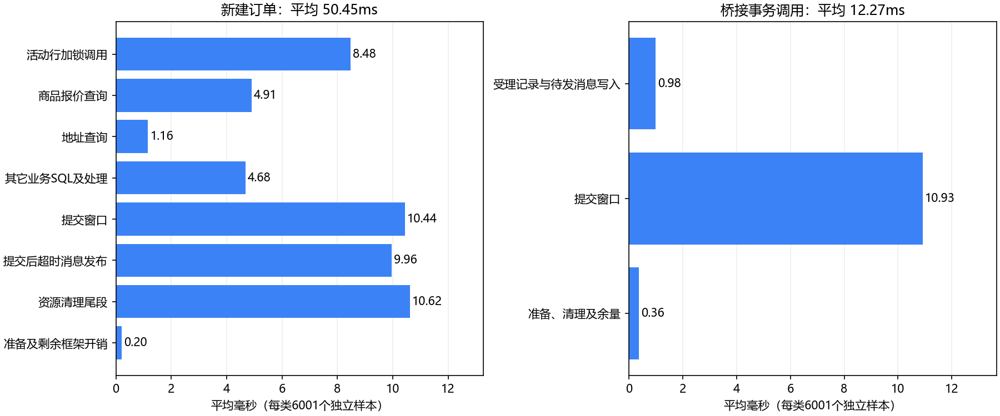

# 消费者及桥接细分计时：2026-10-13

## 结论

正式样本为100 QPS持续60秒，6001笔成功受理、6001笔实际建单成功、0笔失败。另有359次重复消息直接返回，单独标记skipped，未混入新建订单平均值。桥接6001个独立事务样本。

消费者服务调用平均50.450ms，其中事务内方法体19.227ms（38.1%），提交窗口10.442ms（20.7%），提交后超时消息发布9.959ms（19.7%），资源清理尾段10.621ms（21.1%）。这不是用户端到端等待时间，也不包括探针指标写出和Rabbit ACK调用。

桥接事务调用平均12.272ms，业务写入方法体0.980ms，提交窗口10.932ms，提交窗口占89.1%。一条任务一笔事务的提交开销已得到量化。

## 新建订单明细

| 部分 | 平均ms | P95估计ms |
| --- | ---: | ---: |
| 受理快照读取 | 0.303 | 0.422 |
| 商品报价查询 | 4.907 | 15.139 |
| 地址查询 | 1.158 | 2.015 |
| 活动行加锁调用 | 8.479 | 23.060 |
| 受理记录加锁调用 | 0.321 | 0.455 |
| 条件扣库存 | 0.467 | 0.582 |
| 唯一资格写入 | 0.451 | 0.582 |
| 订单写入 | 0.572 | 0.737 |
| 预留记录两次写入 | 0.783 | 1.098 |
| 订单明细写入 | 0.490 | 0.713 |
| 成功状态与同步事件写入 | 0.782 | 0.868 |
| 超时待发消息写入及回调登记 | 0.455 | 0.680 |
| 提交窗口 | 10.442 | 18.743 |
| 提交后发送调用 | 0.214 | 0.422 |
| 提交后Broker确认等待 | 9.156 | 21.987 |
| 提交后发布状态更新 | 0.580 | 0.737 |
| 事务准备段 | 0.172 | 0.276 |
| 资源清理尾段 | 10.621 | 21.889 |
| 服务调用总计 | 50.450 | 87.556 |

超时消息发布总体9.959ms中，等待Broker确认9.156ms。timeout_send、timeout_confirm_wait、timeout_mark_published是timeout_publish的子项；不能再与它相加。body也包含所有事务内细分项。

活动行加锁调用包含SQL执行、JDBC往返和锁等待，不能把它全部当成纯锁等待。提交窗口从诊断beforeCommit回调到afterCommit回调，早于超时消息发送；资源清理尾段从诊断afterCompletion回调到代理返回，包含后续清理/连接状态重置及归还等。两者不是存储fsync的独立计时。

## 优化优先级依据

1. 桥接采用批量持久化，减少当前每笔约11ms的提交窗口开销，同时保留受理记录与待发消息同事务、提交后删除Redis任务及幂等约束。
2. 秒杀的支付超时消息改为事务内仅登记待发事件，后台可靠发送，减少消费者提交后仍阻塞等待Broker的时间。该优化尚未实施；应限定秒杀流程，保持普通订单行为，并按实际订单截止时间处理异步发送延迟。
3. 深入检查清理尾段约11ms的原因。当前提交后还执行待发消息状态更新，可能与后续连接状态重置/提交有关，但本次没有做JDBC方法级验证，不能直接归因。
4. 活动行加锁仍占明显时间；单纯增加消费者可能加剧竞争。先减少上述无谓等待并复测，再评估库存分桶或批量兑现，不能保证上述两项就达到800 QPS。

## 探针与验证

新增sky.seckill.profile-enabled开关，默认false。隔离实例开启后，通过Micrometer收集operation/phase/outcome三个有限维度；没有用户ID或请求ID标签，没有逐单日志。指标为seckill_profile_seconds_count/sum及百分位估计，通过现有/actuator/prometheus导出。

正式实例使用空库sky_perf_timing_final_20261013、独立Redis16380和独立RabbitMQ vhost；账户/商品使用专用测试实例。默认消费者3、prefetch10，未调整业务并发、库存策略或处理期限。测试直接访问隔离交易服务，不包括网关/微信网络或真实支付。

计时以System.nanoTime为准；阶段耗时在服务调用返回后汇总。成功、失败和重复消息分开；事务代理提交失败会归入error，不会冒充created。指标缓存减少探针自身注册开销，百分位保留窗口为30分钟。P95为估计值，不可将各阶段P95相加。

初次诊断轮没有细分事务准备/清理，也未缓存计时器，有37笔等待超时；该轮仅用于发现计时缺口，未纳入本报告。正式结果仅来自最终空库实例。开启探针仍有额外开销，加上同机硬件/后台工作变化，本报告用于归因，不用于宣称生产容量。

桥接total只覆盖SeckillAsyncStore.accept事务调用，不包含Redis扫描、请求查询及任务移除；消费者total覆盖事务代理及提交后回调，不包含MQ排队、失败处理持久化及ACK。相关原始阶段曲线另存stage-samples.jsonl。

25项相关单元/回归测试通过；13项独立集成测试本轮未启用。新增探针测试验证默认关闭、异常传播/上下文清理、提交与提交后计时边界；最终又单独复跑3项探针测试。另有本次真实Redis/MySQL/RabbitMQ及远程服务链路的6001笔验证。

## 文件

- phases.csv / phases.json：计时明细，包含独立样本数量、累计时间、平均及百分位。
- metrics.prom：仅秒杀诊断指标的原始导出，不含认证凭据。
- load-result.json / stage-samples.jsonl：正式负载及阶段推进数据。

业务决策未改变；新增的是默认关闭的可选诊断。库存及补偿核对、专用实例清理结果追加于下方。

## 最终核对和清理

正式样本MySQL及Redis剩余库存均为53999，有效资格6001，无重复资格及负库存，状态同步事件为0。已停止专用测试服务和Redis，删除两个本轮RabbitMQ虚拟主机；隔离库及原始资料保留。原业务服务没有重启或部署。
